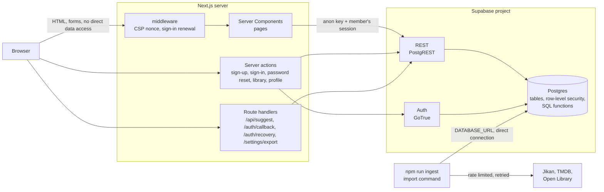

# Architecture

This document describes what is built, how the parts fit together, and why the main decisions were made. It describes the code as it is, not the whole specification: for what is missing, see [STATUS.md](STATUS.md).

## 1. The system at a glance



Three rules shape everything else:

1. **The browser never talks to the database or to Supabase.** All reads and writes happen on the server. The Content-Security-Policy says `connect-src 'self'`, and a browser test fails if a page ever contacts another origin. As a result there are no `NEXT_PUBLIC_` variables and the anon key lives only on the server.
2. **The web app only calls SQL functions, never tables.** The rules (who may see what, what a valid library entry is) live in the database, where row-level security still applies to every call.
3. **Writing the catalog is a separate, privileged path.** Only the import command, using a direct Postgres connection, can write catalog tables. The web app's role has `select` on the catalog and nothing else.

## 2. A request, step by step

1. **Middleware** (`src/middleware.ts`) runs on every page request. It creates a fresh nonce and sets the Content-Security-Policy. If a Supabase session cookie is present it asks the auth server to validate the session, and writes renewed cookies if the token was refreshed (Server Components cannot set cookies, so this has to happen here). It skips static files, the image optimizer and `/api/suggest`.
2. **Pages** are Server Components and are rendered on demand for every request (the build output marks every page route as dynamic; only the icon is static). A page asks `src/lib/data.ts` for a backend (`getBackend`, cached per request) and for the current user (`getCurrentUser`, which calls `auth.getUser()`, a network call to the auth server, also cached per request). If the environment is not configured the page renders a setup screen listing what is missing.
3. **Data calls** go through `src/lib/api/*`. Each function calls one SQL function through `callRpc`, which (a) maps database errors to a small set of `ApiError` codes so raw database messages never reach a visitor, and (b) checks the returned JSON against a zod schema, so a database that answers with an unexpected shape produces a controlled error instead of a broken page.
4. **Mutations** are server actions (`src/app/actions/*`). Each validates its input with zod, calls the database, and returns field-level messages for `useActionState` forms. Success redirects; failure re-renders the form with the visitor's values kept.
5. **Errors**: `src/app/error.tsx` (route-level, with a "Try again" that refreshes server data and resets the boundary), `src/app/global-error.tsx` (root layout failed; reloads the page), `not-found.tsx`, and per-page notices for partial failures such as the sources list on the About page.

## 3. The database

Eight migrations in `supabase/migrations`, applied in name order:

| Migration | Contents |
| --- | --- |
| `…000100_core_catalog` | `titles` (one row per work, all media types), `title_alt_names`, `title_sources` (provenance and attribution per provider), `contributors`, `contributor_sources`, `title_contributors`; trigram and full-text indexes; public read-only policies. |
| `…000200_graph_and_search` | `title_relations` (the connections between titles), helper functions, `search_titles`, `suggest_titles`, `title_facets`, `similar_titles_by_tags`. |
| `…000300_profiles_and_library` | `profiles` (created by a trigger on `auth.users`), `library_entries`, their policies, and `title_rating_summary`. |
| `…000400_api_functions` | The functions the web app calls: `get_title`, `get_library_entry`, `upsert_library_entry`, `remove_library_entry`, `list_library`, `get_profile`, `update_my_profile`, `username_available`, `export_my_data`. |
| `…000500_ingestion_ops` | `ingestion_runs`, `ingestion_errors` (not reachable by the web roles) and the `duplicate_title_candidates` view. |
| `…000600_site_functions` | `catalog_stats`, `catalog_attributions`, `delete_my_account`. |
| `20261104000100_private_notes_and_hardening` | Notes move out of `library_entries` into `library_notes`, a table only the owner can read; the library functions are rewritten to match. Sign-up no longer fails when two people want the same username at the same moment. Members lose the right to write `avatar_url`, which nothing sets. Library listings get a total order, so paging cannot repeat or skip entries that share a timestamp. |
| `20261106000100_streaming_watch` | Curated official provider links, rights-confirmed published MP4/HLS episodes, role-restricted watch-catalogue administration, and per-member private playback progress. |

### Who can do what

| Object | Signed-out visitor | Signed-in member | Import command (direct connection) |
| --- | --- | --- | --- |
| Catalog tables (`titles`, alt names, sources, contributors, relations) | read | read | read and write |
| `profiles` | read public profiles | read public ones and their own; update only `username`, `display_name`, `bio` and `is_public` on their own (`avatar_url` is read-only for them since migration 7) | everything |
| `library_entries` | read entries that are on a public profile and not private | read those plus all of their own; insert, update and delete only their own | everything |
| `library_notes` | no access | read, insert, update and delete only their own | everything |
| `ingestion_runs`, `ingestion_errors`, `duplicate_title_candidates` | no access | no access | everything |
| `title_watch_links`, `title_episodes` | read active official links and published licensed episodes | same, plus explicit watch-admin upsert functions | everything |
| `watch_progress` | no access to rows | read/write only their own progress through the progress function | everything |

Every table has row-level security enabled. The API functions are `SECURITY INVOKER`, so the policies above apply inside them. Functions with privileged writes use `SECURITY DEFINER` with a constrained or empty `search_path` because they must do something the caller's role cannot: `handle_new_user` (creates the profile when an account is created), `title_rating_summary` (counts ratings across all members, including private entries, and returns only totals, never names), `username_available` (looks at every profile, private ones included, and returns only true or false) and `delete_my_account` (removes the caller's `auth.users` row, which cascades to their profile and library).

### Privacy rules, as implemented

- A profile is public by default; the member can switch it to private, after which only they can see it (visitors get a 404).
- Another person sees a library entry only if the profile is public **and** the entry is not marked private.
- Notes are visible to the owner only. They live in their own table, which no one else can read even by querying it directly (row-level security cannot hide one column of a row it lets through, which is why they are not a column of `library_entries`), and the SQL functions return them as null for anyone else.
- A private entry still counts in the title's community average and distribution. The aggregate carries no names. The library box tells the member this before they save.
- A member can download everything the site holds about them as JSON (their profile and library from `export_my_data`, plus the email address and sign-up date, which live with the sign-in service) and delete the account (`delete_my_account`); their ratings then leave the averages.

### Search and ranking

- One function, `search_titles`, serves browsing, filtering, sorting and search across all categories. A query matches by prefix full-text (`simple` configuration on titles, `english` on synopses) **or** by trigram similarity (`pg_trgm`) on the title, the original title or any alternative name. That gives typo tolerance and matching on alternative and translated titles that the providers supply.
- Sorting by score uses a weighted rating, `(v·R + 100·6.5) / (v + 100)`, where `R` is the provider's score and `v` its vote count, so ten votes cannot outrank a million. A title with a score but no vote count is treated as `v = 0` and ranks as 6.5.
- "Similar titles" is the share of genres and themes two titles have in common (Jaccard similarity). It is a content match, labelled as such on the page. It is not personalised.
- Provider scores and member scores are shown separately and labelled with their source. They are never blended.

### The connection graph

`title_relations` stores directed edges (sequel, prequel, adaptation, spin-off, side story and so on) with an inverse for each type, so a link recorded from one side appears on both titles. Relations are imported from providers only (Jikan, with `--relations`). When a relation points at a title that has not been imported, a *stub* title is stored (`is_stub = true`) so the edge is not lost; stubs are hidden from browsing and search, appear in "Connected stories" as "not in the catalog yet", and become real titles when imported. There is no interactive graph view yet.

## 4. Importing data

```
provider API --> adapter (fetch, validate with zod, normalise) --> ingest (one transaction per title) --> Postgres
```

- **Adapters** (`src/lib/providers`) implement one interface for Jikan (anime, manga), TMDB (movie, TV) and Open Library (books). They share an HTTP client that serialises requests, keeps a minimum gap between them (Jikan 1.1 s, Open Library 0.4 s, TMDB 0.15 s), retries 408, 425, 429 and 5xx with exponential backoff and `Retry-After`, never retries other 4xx, and sends a `User-Agent` with a contact address. Provider responses are validated; an item that fails validation is recorded as an error and skipped, and the run continues.
- **Idempotence**: a title's identity is `(provider, external_id)` in `title_sources`. Re-running an import updates in place and reports `inserted`, `updated` or `unchanged`. A transaction-scoped advisory lock per provider record (`pg_advisory_xact_lock`, released on commit or rollback) is meant to stop two overlapping runs from inserting the same title twice. That protection has only been exercised on a single connection, because the test database has just one; two truly concurrent runs have not been tested.
- **Provenance**: every title keeps its source, URL, attribution text and fetch time, and the site shows them.
- **Operations**: each run is logged in `ingestion_runs` with counts and a cursor, failures in `ingestion_errors`. `--resume` continues the last failed or interrupted run of the same job; `--dry-run` fetches and validates but writes nothing; the exit code distinguishes success (0), finished with failed items (2) and failure (1). `duplicate_title_candidates` lists pairs that look like the same work for a human to review; nothing is merged automatically.

## 5. Security design

| Concern | What is done | Where |
| --- | --- | --- |
| Script injection | Content-Security-Policy with a per-request nonce and `strict-dynamic`; no inline script without the nonce; `object-src 'none'`, `frame-ancestors 'none'`, `form-action 'self'`, `base-uri 'self'`. | `src/lib/csp.ts`, `src/middleware.ts` |
| Browser hardening | `X-Content-Type-Options`, `X-Frame-Options: DENY`, `Referrer-Policy`, `Permissions-Policy`, `Cross-Origin-Opener-Policy`, HSTS. | `next.config.ts` |
| Session cookies | `httpOnly`, `SameSite=Lax`, `Secure` when `NODE_ENV` is production. | `src/middleware.ts`, `src/lib/supabase/server.ts` |
| Open redirects | `next` parameters are accepted only as same-site paths. | `src/lib/safe-next.ts` |
| Hostile links and images | External links are limited to http(s); remote images only from three allow-listed hosts. | `src/lib/safe-url.ts`, `src/lib/image-hosts.ts`, `next.config.ts` |
| Account enumeration | Sign-in gives the same message for a wrong password and an unknown address. Sign-up with an address that is already registered says only "We could not create that account. If you already have one, sign in instead." Asking for a password-reset link gets the same answer for every address, including when the sending limit (which the auth service applies only to addresses that have an account) is hit. Usernames are public anyway, so their availability is not hidden. | `src/app/actions/auth.ts`, `src/lib/auth-errors.ts` |
| Password reset | An emailed link carries a one-time code that only the browser that asked for it can redeem (PKCE: the secret half is in that browser's cookie). The code is exchanged on the server at `/auth/recovery`, which signs the visitor in and sends them to choose a password; a link that cannot be used goes back to the request form. Opening a reset link also confirms an address that was never confirmed (the auth service's behaviour, read from its source and reproduced by the stand-in; not tried against a live project). | `src/app/auth/recovery/route.ts`, `src/app/reset-password`, `src/app/forgot-password` |
| Sign-out | Ends this browser's session only (`scope: 'local'`); the auth service's default would also end the member's sessions on every other device. | `src/app/actions/auth.ts` |
| Auth failures | One module maps every auth-service error to a plain message and never reports an outage as a wrong password. | `src/lib/auth-errors.ts` |
| Database access | Row-level security everywhere, least-privilege grants, function-only access from the app. | migrations |
| Secrets | Only the anon key is held by the web app, only on the server; a browser test searches everything the site ships for key material. | `e2e/security.spec.ts` |
| Personal data | Export is `private, no-store`; deletion cascades. | `src/app/settings/export/route.ts`, migration `…000600` |
| Error leakage | Database messages are mapped to a fixed set of friendly messages; an outage test checks that no host names or credentials appear in the page. | `src/lib/api/errors.ts`, `e2e/security.spec.ts` |

Not done: rate limiting of sign-in, sign-up and search (Supabase applies its own limits to auth; the site adds none), CAPTCHA, two-factor sign-in, audit logging, a third-party security review. See [STATUS.md](STATUS.md).

## 6. How it is tested

Two layers, described in [TESTING.md](TESTING.md): unit and database tests run the real migrations in PGlite; browser tests drive a production build against a stand-in for Supabase that also runs the real migrations. The stand-in is test code; it is not shipped and the site's code never imports from it.

## 7. Decisions and trade-offs

- **SQL functions instead of table access from the app.** The rules are enforced once, in the database, and are covered by tests that call the same functions the app calls. The cost is more SQL to maintain and a validator for each function's JSON.
- **No client-side Supabase.** It removes a whole class of exposure (keys, policies mistakes reachable from any browser) and lets the CSP forbid connections to anywhere else. The cost is that pages render on the server and there is no real-time feature path yet.
- **Relational graph modelling rather than a graph database.** Relations are one table with typed, directed edges. That is enough for "connected stories" and one-hop traversal; it would need revisiting for the multi-hop, interactive graph in the specification.
- **Postgres full-text and trigram search rather than a separate search engine.** One system to run, transactional with the data, good for the catalog sizes tested here. It is **not** tested at millions of rows (see STATUS), and semantic or natural-language search is not possible with it alone.
- **No `pgvector`, so no embeddings.** The test database (PGlite) does not include it, so nothing that depends on it could be tested; embeddings, semantic search and the recommendation features that need them are planned, not built.
- **Per-request rendering.** Every page is dynamic because every page reads the session. Public pages could be cached later (the catalog statistics query, for example, runs on each home page view).
- **A stand-in for Supabase in the browser tests.** Docker and the Supabase local stack were not available in the build environment. The stand-in runs the real migrations, which is what matters for the rules, but it cannot reveal differences in the hosted services.

## 8. Where to extend

- **A new provider**: add an adapter in `src/lib/providers` that returns `NormalizedTitle`s (see `types.ts`), register it in `index.ts` with a rate limit, add its credit line to `display.ts`, and add fixtures and tests in the style of `tests/providers`.
- **A new SQL function**: add a migration (never edit one that has been applied anywhere), grant `execute` explicitly, add a zod schema in `src/lib/api/schemas.ts`, wrap it in `src/lib/api/*`, and extend `tests/db/contract.test.ts`.
- **A new page**: follow an existing page for the unconfigured, empty and failure states, and add it to the layout, accessibility and link-crawl tests.
